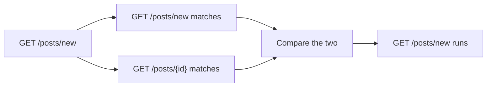
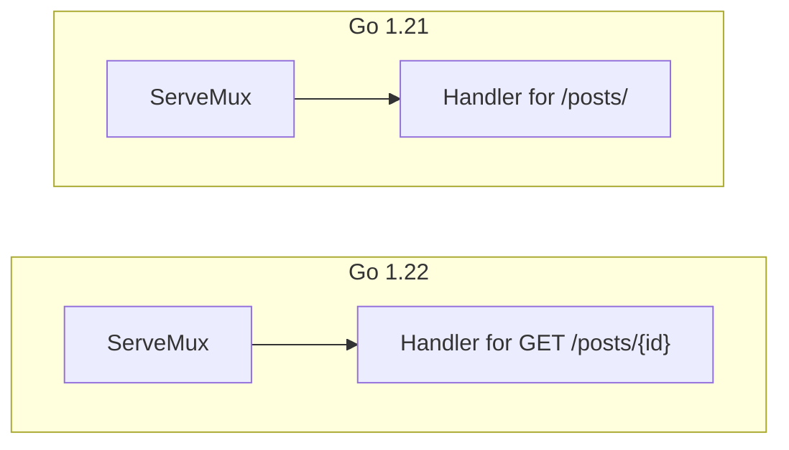
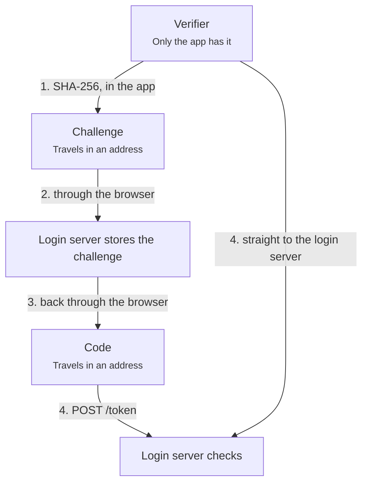
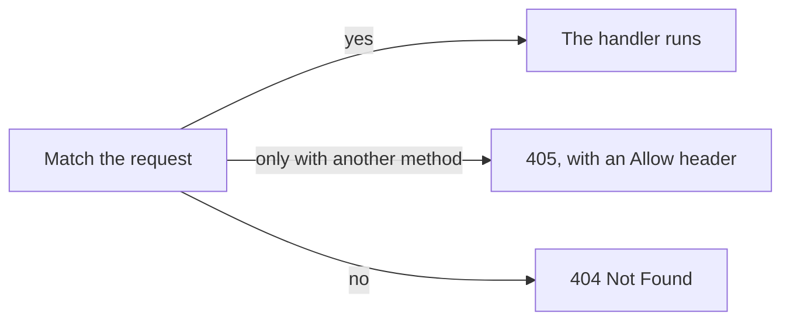

# Where the rules came from

Each rule in [the explain-clearly skill's rules](../explain/references/rules.md) came from a problem a reader hit in a real explanation: the Go router example (`examples/go-router.js`) on 2026-10-15, or the OAuth PKCE example (`examples/oauth-pkce.js`) on 2026-10-17. For each rule, under the same heading and in the same order, this file says what the reader saw before the rule, and what replaced it. Three rules turned out to be about the page, not the writing, and moved to [page-design.md](page-design.md).

## The order of ideas

### The whole, then the problem, then the plan
**From:** OAuth PKCE, Go router.

**Before:** the lesson on PKCE opened with "a stolen code gets nothing". The reader had not yet seen an OAuth login, so they did not know where the code comes from, where it goes, or why anyone would steal it. The Go router lesson opened straight on the matching rules, so the reader started without knowing what it covers or where it goes, and it never linked the changes it explains.

**After:** the OAuth lesson starts with a plain OAuth login, message by message, with no PKCE. Step 2 is the problem, a stolen code. Step 3 is PKCE, as the same login with two values added. The Go router's first step, What changed, says the change in one sentence, shows both versions, lists the steps that follow, and links proposal golang/go#61410 and the four main reviews in Gerrit.

### Each step stands on the steps before
**From:** OAuth PKCE.

**Before:** three steps walked the same login, each from another angle, so the reader met the same messages three times. A fourth step, the token refresh, did not help explain PKCE at all.

**After:** the four steps are the login, the problem, PKCE, and the theft with PKCE. The refresh is one sentence in step 1, and the Basics tab shows it.

### Facts first, then a picture, then the real why
**From:** OAuth PKCE, Go router.

**Before:** step 1 of the OAuth lesson opened with the cloakroom, then walked the login. The reader met a picture of something they had not yet seen, so they could not tell what it was a picture of. In the Go router, a step went straight to Go's rule and its mechanism, with no picture at all. The reader only understood it after rebuilding a simpler one on their own: the routes sorted from most to least specific, checked from the top, first match wins.

**After:** OAuth step 1 walks the login first, then asks "Why a code first, and not the tokens straight away?" and answers with the cloakroom. The Go router step gives "A model you can use: picture the routes sorted from the most specific to the least. A request is checked from the top, and the first route that matches wins." Later: "What Go really does. It gets the same answer without sorting anything", then the startup check and the tree search, in two numbered steps.

### Start from the reader's natural guess
**From:** Go router.

**Before:** the step argued against "the one registered first" and "the longest". For this request the obvious guess is the exact match, which the text never mentioned.

**After:** "Your first guess is probably the exact match, route 1, and it is right." For how it works, most readers picture the request being checked against the routes in some order, so the step starts from that picture instead of avoiding it.

### Offer background to look up, outside the lesson
**From:** Go router.

**Before:** the lesson assumed the reader knew what a method, a host, and a path are, so someone new to HTTP had nowhere to start.

**After:** a Basics tab, "An HTTP request in one minute", covers them, and the first step points to it.

## Making the key points land

### Give the key points the most care
**From:** Go router.

**Before:** the most important sentence of the lesson was the hardest to follow: "the more specific route wins, meaning the one that matches a strict subset of the other's requests". It did not say what "more specific" looks like, or what a subset of requests is.

**After:** the rule became "the route that spells out more of the request wins", then a table comparing the method and each path segment of the two routes, then an analogy with addresses, where `{id}` is "any house". The precise "strict subset" wording moved into the note.

### Use an everyday picture where it fits
**From:** OAuth PKCE.

**Before:** the cloakroom, a ticket for a coat and a card torn in two, was the part of the lesson the reader remembered. The OAuth login before it had players and messages but nothing to picture, so it was harder to hold in mind.

**After:** the cloakroom starts in step 1, where the crowded counter is the browser, a quiet back window is the direct path, the ticket is the code, and the coat is the tokens. Step 2 adds a pickpocket and a staff badge, and step 3 the torn card.

### Carry one analogy through
**From:** Go router.

**Before:** the letters to "12 Main St" and "12 Main St, Apt 4" came after the routes, as a one-line aside. The reader had already struggled with the routes by the time the picture that made them easy arrived, and the rest of the step never used it again.

**After:** the step opens with imagined sorted addresses: a house, a street, a city. Then "A route is an address for requests": the method is the city, each segment the next part, and `{id}` is "any house", in a table with the routes on the left and their addresses on the right. "What Go really does" is a mail room that never writes the list down, and the clash in the next step is two addresses that cannot be put in order.

### Pick examples that show the point to every reader
**From:** Go router.

**Before:** the matching step said an index finds the candidates, but never showed what it stores, or a conflict. In the analogy, "12 Main St, Apt 4" is how addresses are written in the US. Readers elsewhere write them in another order and with other words, so the example asked them to translate first.

**After:** a box shows what the index holds for the example's routes, a map from a segment position and its literal to the routes that have it there, and the comparison that clashes is red. The analogy's addresses became "Lyon, Rose Street, house 12": a city, a street, and a house, named outright and written from the largest part to the smallest, the same order as a route.

### Tell look-alikes apart by their jobs
**From:** OAuth PKCE.

**Before:** a code and an access token are both random strings from the login server, and the reader kept mixing them up. The lesson used both words without ever showing what each was for.

**After:** step 1 has a table with the code `kebUrZQWTL_-3VXPX_2HUQ` in one column and the access token `at_1KTuiveM4YrC1j_33md3Vn-_` in the other: through the browser once against direct on every API call, getting the tokens against reading the data.

## Sentences

### Name the specifics every time
**From:** Go router.

**Before:** "GET /posts/new matches two patterns. Which one runs?" did not say which two patterns.

**After:** "matches two routes: GET /posts/new, and GET /posts/{id} with id = new".

### Say when each thing happens
**From:** Go router.

**Before:** "Go compares the two routes with each other" sat in the middle of a request's journey, so it read as work done on every request. It happens once, at startup, when a route is registered.

**After:** "**At startup**, each new route is compared with the routes it could clash with" and "**When a request comes in**, Go walks a tree". The diagram labels the comparison "At startup".

### Use lists for parallel items, each with an example
**From:** Go router.

**Before:** "Each part gives one of five answers: the same, more specific, more general, no overlap, or overlap with neither containing the other." Five ideas were packed into one sentence, and none had an example.

**After:** the five answers are a numbered list, such as "4. **No overlap.** `/posts/new` against `/posts/edit`. No request matches both."

### Mark every identifier in the text
**From:** Go router.

**Before:** in "A letter to house 7 stops at 2" and "GET /posts/42 reaches route 2", the names of things ran together with the words around them, so the reader had to find where each name started and ended.

**After:** "A letter to `house 7` stops at 2", and "`GET /posts/42` is the letter to `house 7`: it reaches route 2", with the request and the routes in their type colors.

## What the diagram draws

### The step's point is the clearest thing in the picture
**From:** Go router.

**Before:** the step "Neither wins: refused at startup" had a diagram that was mostly how a route is parsed. In the tree step, the root, the method, and every segment were drawn alike, so the reader could not tell which were central and which had something worth opening.

**After:** the refused-at-startup diagram is registration → the index finds candidates → each comparison → the panic, and the parsing is gone. In the tree step, the story walks the path the request takes, GET → posts → {id} → comments, and a dot marks the parts with code to open.

### Draw what happens, not a sentence
**From:** Go router.

**Before:** "The more specific pattern wins" was drawn as a sentence laid out in boxes: "pattern A" → "is more specific than" → "pattern B" → "wins".

**After:** the boxes show what the router does:

### Put what is compared side by side
**From:** Go router.

**Before:** Go 1.21 was lesson step 1 and Go 1.22 was step 2. The reader had to keep the first picture in mind while looking at the second, so the change itself was hard to see.

**After:** both are in one chart:

### Build each picture on the one before
**From:** OAuth PKCE.

**Before:** steps 1 to 3 of the OAuth lesson were sequence charts with the same players in the same places, but step 4 was a flowchart of two boxes side by side. The reader had to learn a new picture for the last point, instead of seeing what changed in the one they knew.

**After:** step 4 is step 2's theft against step 3's login: the same sequence chart and bands, with the verifier and challenge from step 3, and the attacker's two failed tries where step 2 had its success.

### Make the places that change the answer stand out
**From:** OAuth PKCE.

**Before:** the whole point of PKCE is that some messages pass through the browser, where others can read them, and some go straight to a server. The diagrams drew both kinds the same way, so the reader had to keep the difference in mind. Another step, on who holds which value, went the other way: it put each value in a box for where it is, only in the app, in addresses, and on the login server. The values move between those places in turn, so the arrows crossed back and forth, and the chart was shrunk to a third of its size to fit.

**After:** the messages through the browser sit on a red band, "Through the browser: other programs may see these", and the direct ones on a green band, "Direct: only the app and the server see these". The three boxes became one chain down the page. The verifier's arrow to the check runs beside the chain, so the picture shows that it skips the browser:

### Arrows get labels, not notes
**From:** Go router.

**Before:** every arrow had its own side-panel note, mostly one short sentence.

**After:** that sentence is the arrow's label:

## Color

### Color carries meaning
**From:** Go router.

**Before:** the page and the diagrams were almost all gray, so nothing told the eye where to look. In the step "Neither wins: refused at startup", every box was gray, including the clash itself.

**After:** the losing comparison and the panic are red and marked Problem, and the 405 answer in the last step is green and marked New.

### Give each type of thing one color, everywhere
**From:** Go router, OAuth PKCE.

**Before:** in "The request GET /posts/new matches two routes: GET /posts/new, and GET /posts/{id}", a request and a route looked the same, so the reader had to work out which was which, every time. Later, in the OAuth lesson, codes and tokens had their own colors, but some arrows that carried the code and some mentions of it were plain, so the colors could not be trusted.

**After:** in the Go router, requests are violet, routes teal, handlers pink, and the router blue. In the OAuth lesson, every message that carries the code is the code's color, in all four steps, and so is every word "code" that means the value.

### Color says what a thing is, not when it appeared
**From:** OAuth PKCE.

**Before:** in the step on a stolen code, the attacker and every request it sends came out green and marked New, because the step added them. Green read as good news, and the requests lost the pink that every code has in the lesson.

**After:** the attacker is red and marked Problem, the requests that carry the stolen code are pink like every code, and only the two refusals PKCE adds are green.

## Text and picture together

### Don't repeat an explanation
**From:** Go router, OAuth PKCE.

**Before:** in the Go router, a step had four tables, and the two routes appeared in three of them. The same fact, that the more specific route runs, was said in the summary, the story, a card, and two notes. In the OAuth lesson, every shape and arrow had a tooltip, and most repeated the label or the arrow's text, so the reader found them noise: one more thing to read, with nothing new in it.

**After:** the separate table of the two routes in order is gone, because the part-by-part table already shows their order, and the note on newPostForm no longer repeats the tree search the story describes. The OAuth PKCE example has no tooltips: its labels say what each part is, and the notes hold the real requests from the run.

### Keep the text and the picture in step
**From:** Go router, OAuth PKCE.

**Before:** the story sat in the side panel and the diagram in the middle, and they met only when the reader pointed at a link. A reader who simply read saw a picture that never changed, and had to find each message the text named, such as "the redirect back to the app", by themselves.

**After:** reading "One login, without PKCE", the picture lights only messages 2 and 4, and the links read "2 sends her browser to the login server" and "4 sends her browser back to the app", with the same dark dots as the arrows.

### Point at what matters
**From:** Go router.

**Before:** the note on registering /posts/new showed lines 2737–2779 of server.go, and the reader could not find the conflict check in them.

**After:** `mark=2764-2774` highlights the lines that check it against each candidate, and the panel scrolls to them.

### Every part is introduced in the text
**From:** Go router.

**Before:** under the story, a plain list, "Other parts, to open for detail", held the parts the story did not mention, such as both ServeMux boxes in "What changed". Nobody read it, because a list of names says nothing about why each part is there.

**After:** the story says "the Go 1.21 ServeMux matches only the path", and the word ServeMux opens that box's note.
