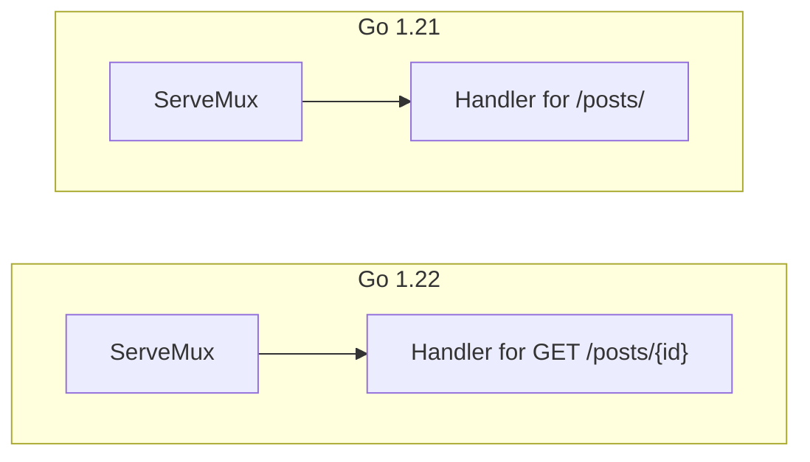
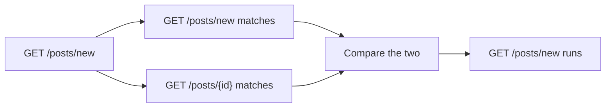
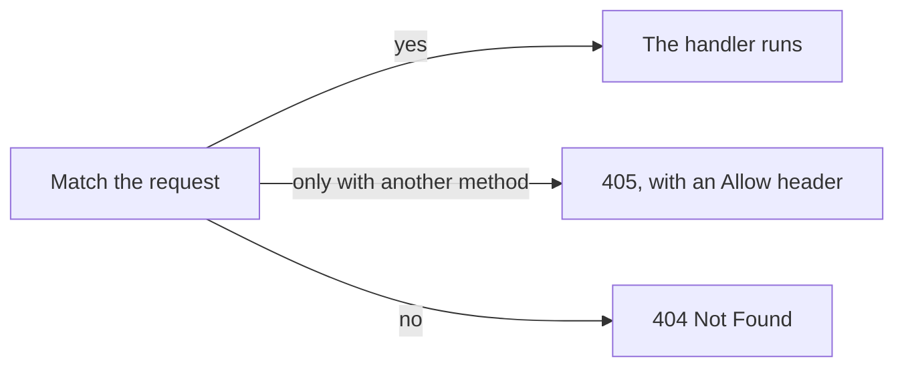
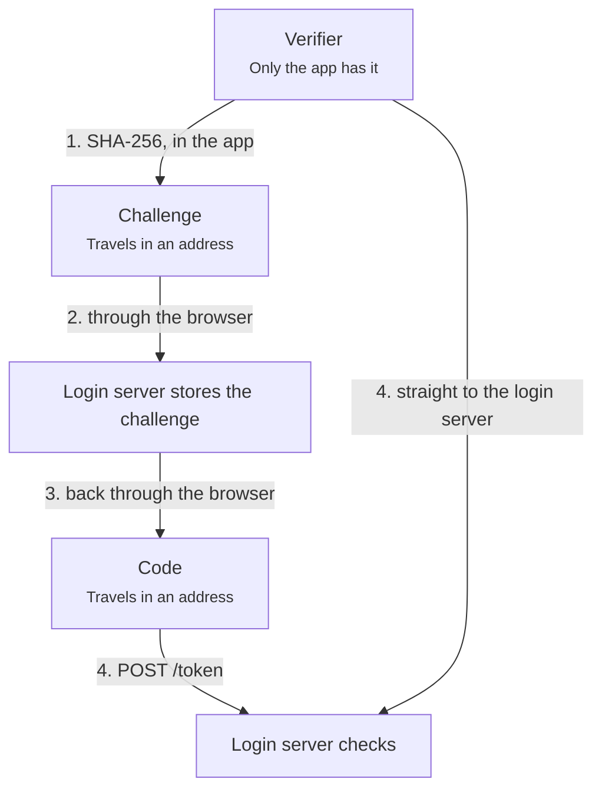

# Rules

Rules that came from reading real explanations. Each says where it came from and what to do. The first set came from the Go router example (`examples/go-router.js`) on 2026-10-15. The last eleven came from the OAuth PKCE example (`examples/oauth-pkce.js`) on 2026-10-17: two from writing it, and nine from a reader's reviews of it. Most are advice for writing an explanation. Where the page helps, a **How** line says with what. An **Example** says what the reader saw before the rule, and what replaced it. The format is in `skill/references/format.md`.

### Color carries meaning
**Context:** The page and the diagrams are almost all gray, so nothing tells the eye where to look.
**Rule:** Use a few colors, each with one meaning, in both the page and the diagrams. For example, new, changed, removed, and a problem such as a conflict, which is red. Color is never the only signal, so a label or icon goes with it.
**How:** `status` on a note: `new`, `changed`, `removed`, or `problem`. The word shows in the note and on the part's card.
**Example:** in the step "Neither wins: refused at startup", every box was gray, including the clash itself. Now the losing comparison and the panic are red and marked Problem, and the 405 answer in the last step is green and marked New.

### The reader knows how to read a view
**Context:** In a story, it was not clear whether to click the part cards as they come up, or to read to the end first.
**Rule:** The story reads top to bottom with no clicks. Opening a part is optional, and the page shows that.
**How:** the story starts with a hint to read it top to bottom, and its part cards are drawn as asides.
**Example:** a story's part cards were full-width buttons between its paragraphs, so the reader stopped at each one. Now the story opens with "Read top to bottom. Click a part only when you want more detail.", and each card is a small aside with a rule on its left and a ›.

### Details open without hiding the big picture
**Context:** Reading the story, the reader opened a part from a link. Its note replaced the story, so they lost their place and had to go back to keep reading.
**Rule:** Opening a detail never hides the overall picture. The reader sees the story and the part's note at the same time, and the story stays where they left it.
**How:** a part's note opens inside the story, under the card or link that was clicked, or as a card on the canvas beside its shape. The story keeps its scroll either way ([ADR-053](decisions/053-inline-and-peek-notes.md)).
**Example:** on the overview, clicking Handler for /posts/ in the story swapped the whole story for that handler's code. Now the code opens under that card, between the paragraphs the reader was on.

### Every part is introduced in the text
**Context:** Under the story, a plain list, "Other parts, to open for detail", held the parts the story did not mention. Nobody read it, because a list of names says nothing about why each part is there.
**Rule:** The story links each part that has something to open, at the sentence that talks about it. Don't leave parts for a list at the end.
**How:** a view with a story has no parts list. A check names each part with a note that its story never links, except parts an earlier lesson step already showed.
**Example:** "What changed" listed both ServeMux boxes under the story. Now the story says "the Go 1.21 ServeMux matches only the path", and the word ServeMux opens that box's note.

### Show how parts belong together
**Context:** The note opened under the story looked like a second, separate panel, though it was the detail of one card in the story.
**Rule:** When one thing is a detail of another, the page shows the link with position, a border, or a shared color: a note and its part, an inner diagram and its shape, a step and its lesson. The reader should never have to guess what belongs to what.
**How:** an inline note sits directly under its card, with the card's blue rule and a lighter tint, and the card's › turns down. A peek card sits against its shape, with an arrow pointing at it.
**Example:** "Your code, before" sat under the story at full width, with a plain gray line between them. Now it opens under the Handler for /posts/ card, as that card's lower half.

### The diagram shows how much each part matters
**Context:** Every shape looked the same, so the reader could not tell which ones were central and which ones had something worth opening.
**Rule:** A diagram tells the reader how much each part is worth: what is central to the point, what is background, and what has more to open. Never leave every part looking equal.
**How:** the story names what is central, and parts that are only background stay out of the picture. The page adds a dot to every part that has more to read.
**Example:** in the tree step, the root, the method, and every segment were drawn alike. Now the story walks the path the request takes, GET → posts → {id} → comments, and a dot marks the parts with code to open.

### Show a change side by side
**Context:** Before and after were two lesson steps. The reader had to keep the first in mind while looking at the second, so the change itself was hard to see.
**Rule:** Show the states being compared on the same page, next to each other, with what changed marked. Don't split a comparison across two pages.
**How:** two `subgraph`s in one flowchart, joined by `~~~`, with `status` on what changed.
**Example:** Go 1.21 was lesson step 1 and Go 1.22 was step 2, so the reader had to remember the first picture while looking at the second. Now both are in one chart:



### Point at what matters
**Context:** A note showed a 40-line function, and the reader could not tell which lines mattered.
**Rule:** Whenever a piece of code, a list, or a diagram is bigger than its point, highlight the part that carries the point. The reader should never have to search for it.
**How:** `mark=` on a code fence highlights lines inside the ones shown. In a diagram, `status` marks the parts that changed.
**Example:** the note on registering /posts/new showed lines 2737–2779 of server.go, and the reader could not find the conflict check in them. Now `mark=2764-2774` highlights the lines that check it against each candidate, and the panel scrolls to them.

### The diagram and the panel say what they each show
**Context:** A call order was on the left and source code on the right, and the reader did not see how they connect.
**Rule:** Make the link visible: the panel describes the selected part, and the view says what the diagram shows.
**How:** opening a note brings its part into view, outlined in the panel's blue, and a part's card or link lights it in the diagram on hover. The story says what the diagram shows.
**Example:** a step had the call order as boxes on the left and Go source in the panel on the right, with nothing saying they were the same function. Now pointing at the function's card lights its box, and the open box has an outline in the same blue as the card.

### Start with an overview and a plan
**Context:** The reader started without knowing what the lesson covers or where it goes.
**Rule:** The first view gives the change in one sentence, before and after at a glance, and the list of steps ahead.
**Example:** the lesson opened straight on the matching rules. Now the first step, What changed, says the change in one sentence, shows both versions, and lists the steps that follow.

### Link the original change
**Context:** The explanation never linked the PR, issue, or commits it explains.
**Rule:** The first view links the original change. If there is no single PR, it links the proposal and the commits.
**Example:** the router came from many changes, so there was nothing to link. Now the first step links proposal golang/go#61410 and the four main reviews in Gerrit.

### Offer the basics, easy to skip
**Context:** A reader new to the topic, for example someone who doesn't know what an HTTP request is made of, had nowhere to start.
**Rule:** Put the basics where an experienced reader never has to pass through them, and point to them from the first step.
**How:** a second tab, such as Basics, outside the lesson.
**Example:** the lesson assumed the reader knew what a method, a host, and a path are. Now a Basics tab, "An HTTP request in one minute", covers them, and the first step points to it.

### Name the specifics every time
**Context:** "GET /posts/new matches two patterns. Which one runs?" did not say which two patterns.
**Rule:** Name the concrete items in the sentence that uses them. Don't expect the reader to remember them from an earlier step.
**Example:** "matches two patterns" became "matches two routes: GET /posts/new, and GET /posts/{id} with id = new".

### Draw what happens, not a sentence
**Context:** "The more specific pattern wins" was drawn as a sentence laid out in boxes.
**Rule:** Draw a process in the order it happens, such as request → two matches → the winner. A rule belongs in the text.
**Example:** the boxes read "pattern A" → "is more specific than" → "pattern B" → "wins". Now they show what the router does:



### The diagram shows the step's point
**Context:** The step "Neither wins: refused at startup" had a diagram that was mostly the parsing process.
**Rule:** The main part of the diagram is what the title says. Cut parts that are not that point.
**Example:** most of the refused-at-startup diagram was how a route is parsed. Now it is registration → the index finds candidates → each comparison → the panic, and the parsing is gone.

### Arrows get labels, not notes
**Context:** Every arrow had its own side-panel note, mostly one short sentence.
**Rule:** Put the arrow's meaning in a label on the diagram. Give an arrow a note only when it has real detail, such as code.
**How:** write the meaning as a Mermaid arrow label, and the arrow as `[from, to]`. Arrows with no detail stay out of the parts list.
**Example:** each arrow in the last step had a side-panel note of one short sentence. Now that sentence is the arrow's label:



### Show the data with real values
**Context:** The matching step did not show a conflict, or what the index stores.
**Rule:** Show the data structures filled with the example's real values, and mark problem cases, such as a conflict in red.
**Example:** the matching step said an index finds the candidates, but never showed it. Now a box shows what the index holds for the example's routes, a map from a segment position and its literal to the routes that have it there, and the comparison that clashes is red.

### Give each type of thing its own color
**Context:** "The request GET /posts/new matches two routes: GET /posts/new, and GET /posts/{id}." A request and a route look the same in that sentence, so the reader had to work out which was which, every time.
**Rule:** Give each type of thing the explanation keeps naming one color, and use it in the diagram and in the text. The colors become a small sign language: once the reader knows that routes are teal, they don't need to read the word.
**How:** `DIAGRAMS.types` names the types, such as `request`, `route`, and `handler`. A shape takes `type: "route"`. In text, `[GET /posts/{id}](~route)` shows the words in that color, and a link to a part with a type has its color too. The page picks the colors, up to four, and the legend names them.
**Example:** in the Go router, requests are violet, routes teal, handlers pink, and the router blue, in every step and in the text that names them.

### Line up what is compared
**Context:** The same sentence named the request and two routes in a row, so the one difference between them, `new` against `{id}`, was hidden in the middle of the text.
**Rule:** When the point is a difference, put the things side by side in aligned rows, one per line, so the eye can scan down a column and see what changes.
**How:** a markdown table. With an empty header row, it shows no header.
**Example:** the sentence became

```text
request   GET /posts/new
route 1   GET /posts/new
route 2   GET /posts/{id}   with id = new
```

### Ask the reader a question rarely
**Context:** "Which one runs?" was asked in the lesson plan and again in the step.
**Rule:** A question can make the reader guess before they read the answer, which helps them remember it. Use it once, at the step's hardest point, not as a habit.
**Example:** the plan now says "`GET /posts/new` matches two of these routes, and the more specific one runs". Only the step itself asks "Which one runs?"

### Start from the reader's natural guess
**Context:** The step argued against "the one registered first" and "the longest". For this request the obvious guess is the exact match, which the text never mentioned.
**Rule:** Start from the guess most readers would make, about the answer and about how it works. Say whether it is right, then show what the rule adds beyond it. Don't argue against guesses few readers would make, and don't step around the model most readers already hold.
**Example:** "Your first guess is probably the exact match, route 1, and it is right." For how it works, most readers picture the request being checked against the routes in some order, so the step starts from that picture instead of avoiding it.

### Spend the most care on the key idea
**Context:** The most important sentence of the lesson was the hardest to follow: "the more specific route wins, meaning the one that matches a strict subset of the other's requests". It did not say what "more specific" looks like, or what a subset of requests is.
**Rule:** Find the one idea the explanation depends on, and give it more than a definition: a picture or a table of a worked case, an analogy from everyday life, and a plain rule of thumb. Keep the exact wording for those who want it, after the plain one.
**Example:** the rule became "the route that spells out more of the request wins", then a table comparing the method and each path segment of the two routes, then an analogy with addresses, where `{id}` is "any house". The precise "strict subset" wording moved into the note.

### Use lists for parallel items, each with an example
**Context:** "Each part gives one of five answers: the same, more specific, more general, no overlap, or overlap with neither containing the other." Five ideas were packed into one sentence, and none had an example.
**Rule:** Put three or more items of the same kind in a numbered or bulleted list, and give each one an example. Keep prose for reasoning, so lists stay the exception.
**Example:** the five answers are now a numbered list, such as "4. **No overlap.** `/posts/new` against `/posts/edit`. No request matches both."

### Say when each thing happens
**Context:** "Go compares the two routes with each other" sat in the middle of a request's journey, so it read as work done on every request. It happens once, at startup, when a route is registered.
**Rule:** When a system works in phases, such as startup and request time, or build and run, attach every action to its phase. Say it in the sentence, and show it in the diagram.
**Example:** the step now says "**At startup**, each new route is compared with the routes it could clash with" and "**When a request comes in**, Go walks a tree". The diagram labels the comparison "At startup".

### Give a model first, then say how reality differs
**Context:** The step went straight to Go's rule and its mechanism. The reader only understood it after rebuilding a simpler picture on their own: the routes sorted from most to least specific, checked from the top, first match wins.
**Rule:** Give the reader a model they can run in their head and that predicts the right result. Say it is a model. Then say what the system really does, and why the two give the same answer.
**Example:** "A model you can use: picture the routes sorted from the most specific to the least. A request is checked from the top, and the first route that matches wins." Later: "What Go really does. It gets the same answer without sorting anything", then the startup check and the tree search, in two numbered steps.

### Every sentence is literally true
**Context:** "It never compares a route with the request" was false as written, because matching a request means checking it against routes. It meant something narrower: when two routes match, Go does not pick by checking which is closer to the request.
**Rule:** A sentence must be true without a hidden qualifier. If it is true only in a narrow reading, rewrite it to say the narrow thing, or say plainly that it is a simplification.
**Example:** the sentence is gone. The step now says when routes are compared with each other, at startup, and what happens to a request, a walk down the tree.

### Bring the analogy in early, and carry it through
**Context:** The letters to "12 Main St" and "12 Main St, Apt 4" came after the routes, as a one-line aside. The reader had already struggled with the routes by the time the picture that made them easy arrived, and the rest of the step never used it again.
**Rule:** When an analogy carries the key idea, bring it in before the details: right after a short, plain account of what happens (see Show what happens, then why), and worked out on its own with a few concrete cases. Then map the real case onto it explicitly, part by part, with the real thing on the left and the analogy on the right, so the reader never has to work out which part is which. Keep using its words for later points, including where the analogy and the real thing differ.
**Example:** the step opens with imagined sorted addresses: a house, a street, a city. Then "A route is an address for requests": the method is the city, each segment the next part, and `{id}` is "any house", in a table with the routes on the left and their addresses on the right. "What Go really does" is a mail room that never writes the list down, and the clash in the next step is two addresses that cannot be put in order.

### An analogy says it is imagined
**Context:** "A mail room keeps its addresses sorted from the most exact to the least" read as a claim about real mail rooms. The reader stopped to wonder whether it was true, which does not matter to the point.
**Rule:** Present an analogy as a picture, not as a fact about the world: "imagine", "picture", "suppose". The word is enough, so the reader spends no attention checking it. A general warning that the real thing may differ only adds noise. Where a difference matters, name that one difference, in the analogy's words, as the rule above says.
**Example:** "Imagine a mail room that sorts its addresses from the most exact to the least, and sends each letter to the first one that fits."

### Use examples every reader knows
**Context:** "12 Main St, Apt 4" is how addresses are written in the US. Readers elsewhere write them in another order and with other words, so the example asked them to translate first.
**Rule:** Pick examples that read the same in any country and culture, or build them from parts everyone shares. Avoid local formats, units, holidays, and sports, unless the subject is local.
**Example:** the addresses became "Lyon, Rose Street, house 12": a city, a street, and a house, named outright and written from the largest part to the smallest, the same order as a route.

### Say each thing once
**Context:** The step had four tables, and the two routes appeared in three of them. The same fact, that the more specific route runs, was said in the summary, the story, a card, and two notes.
**Rule:** Give each point one place. When a point comes back, refer to it instead of restating it. A note can repeat what the story says only when it would not make sense without it.
**Example:** the separate table of the two routes in order is gone, because the part-by-part table already shows their order. The note on newPostForm no longer repeats the tree search the story describes.

### Mark every identifier in the text
**Context:** In "A letter to house 7 stops at 2" and "GET /posts/42 reaches route 2", the names of things ran together with the words around them, so the reader had to find where each name started and ended.
**Rule:** Set every name the reader may need to spot again apart from the prose: code values, labels such as route 1, and the analogy's names such as house 12. Use the type's color where the thing has a type, and code style otherwise.
**Example:** "A letter to `house 7` stops at 2", and "`GET /posts/42` is the letter to `house 7`: it reaches route 2", with the request and the routes in their type colors.

### Color says what a thing is, not when it appeared
**Context:** In the step on a stolen code, the attacker and every request it sends came out green and marked New, because the step added them. Green read as good news, and the requests lost the pink that every code has in the lesson.
**Rule:** When the steps of a lesson are different runs or cases, not one picture that changes, color each part by what it is and how it ends, not by the step that adds it.
**How:** a part with a `type` keeps its color on the step that adds it. `status: "problem"` marks what goes wrong, and `status: "new"` what the change adds.
**Example:** the attacker was a green box marked New, and so were its requests. Now the attacker is red and marked Problem, the requests that carry the stolen code are pink like every code, and only the two refusals PKCE adds are green.

### Group by place only when the flow stays straight
**Context:** The step on who holds which value put each value in a box for where it is: only in the app, in addresses, and on the login server. The values move between those places in turn, so the arrows crossed back and forth, and the chart was shrunk to a third of its size to fit.
**Rule:** When things move between places, draw them in the order they move, in one direction. Say where each one is in its caption, and keep groups for things that stay together.
**How:** a top-to-bottom flowchart with no `subgraph`, and the place in each shape's caption. The story's table says who holds what.
**Example:** the three boxes became one chain down the page. The verifier's arrow to the check runs beside the chain, so the picture shows that it skips the browser:



### Show the whole before the part
**Context:** The lesson on PKCE opened with "a stolen code gets nothing". The reader had not yet seen an OAuth login, so they did not know where the code comes from, where it goes, or why anyone would steal it.
**Rule:** Before explaining a part, show the whole system it belongs to, once, with its main players and one worked example. Then say the problem, then the part that solves it.
**Example:** the lesson now starts with a plain OAuth login, message by message, with no PKCE. Step 2 is the problem, a stolen code. Step 3 is PKCE, as the same login with two values added.

### Find an everyday picture for each hard idea
**Context:** The cloakroom, a ticket for a coat and a card torn in two, was the part of the lesson the reader remembered. The OAuth login before it had players and messages but nothing to picture, so it was harder to hold in mind.
**Rule:** People imagine everyday, physical things more easily than abstract ones, so a good real-world analogy is one of the strongest tools an explanation has. Look for one wherever the reader must keep an idea in their head, not only at the key idea. Prefer growing one analogy over the whole lesson to adding a new one per step.
**Example:** the cloakroom now starts in step 1, where the crowded counter is the browser, a quiet back window is the direct path, the ticket is the code, and the coat is the tokens. Step 2 adds a pickpocket and a staff badge, and step 3 the torn card.

### Tell look-alikes apart by their jobs
**Context:** A code and an access token are both random strings from the login server, and the reader kept mixing them up. The lesson used both words without ever showing what each was for.
**Rule:** When two things look alike, put them side by side and say for each where it is made, where it travels, what it is used for, and how long it lasts, with a real value of each.
**Example:** step 1 has a table with the code `kebUrZQWTL_-3VXPX_2HUQ` in one column and the access token `at_1KTuiveM4YrC1j_33md3Vn-_` in the other: through the browser once against direct on every API call, getting the tokens against reading the data.

### Color a type everywhere it appears
**Context:** Codes and tokens had their own colors, but only some mentions used them. Other mentions of the same values in the text, and some arrows that carried them, stayed plain, so the colors could not be trusted.
**Rule:** Once a thing has a type color, use it on every mention: each word in the text that names it, each shape, and each arrow that carries it. A color used only sometimes tells the reader nothing.
**How:** `[code](~code)` in text, and `type` on each shape and on each arrow, also in `arrow()`.
**Example:** every message that carries the code is the code's color, in all four steps, and so is every word "code" that means the value.

### Draw the places that change the answer
**Context:** The whole point of PKCE is that some messages pass through the browser, where others can read them, and some go straight to a server. The diagrams drew both kinds the same way, so the reader had to keep the difference in mind.
**Rule:** When it matters where something happens, such as an exposed place and a private one, or a client and a server, draw those places in the diagram, and name them in it.
**How:** in a sequence chart, `rect` shades a block of messages, and a `Note over` at its top names it. In a flowchart, a `subgraph`.
**Example:** the messages through the browser sit on a red band, "Through the browser: other programs may see these", and the direct ones on a green band, "Direct: only the app and the server see these".

### Give each step one new idea
**Context:** Three steps walked the same login, each from another angle, so the reader met the same messages three times. A fourth step, the token refresh, did not help explain PKCE at all.
**Rule:** Each step adds one idea the steps before did not have. Merge steps that show the same thing, and cut a topic that does not serve the lesson's point, or reduce it to a sentence where it fits.
**Example:** the four steps are now the login, the problem, PKCE, and the theft with PKCE. The refresh is one sentence in step 1, and the Basics tab shows it.

### Add a layer only when it carries something
**Context:** Every shape and arrow had a tooltip. Most repeated the label or the arrow's text, and the reader found them noise: one more thing to read, with nothing new in it.
**Rule:** Each layer the reader can open, such as a tooltip, a note, or an inner diagram, must say something the layer above it does not. Leave it out otherwise.
**How:** `tooltip` is optional ([ADR-057](decisions/057-optional-tooltips.md)). A part with no tooltip still lights up on hover.
**Example:** the OAuth PKCE example has no tooltips. Its labels say what each part is, and the notes hold the real requests from the run.

### Show what happens, then why
**Context:** Step 1 of the OAuth lesson opened with the cloakroom, then walked the login. The reader met a picture of something they had not yet seen, so they could not tell what it was a picture of.
**Rule:** In each step, first say plainly what happens, in the order it happens, with the diagram. Then explain why it works or why it is built that way, with the analogy. The reader then has the facts in mind for the reasons to explain.
**Example:** step 1 now walks the login first, then asks "Why a code first, and not the tokens straight away?" and answers with the cloakroom. Step 2 runs the theft before saying why the code alone is enough, and step 3 shows the login with PKCE before the torn card.

### Build each picture on the one before
**Context:** Steps 1 to 3 of the OAuth lesson were sequence charts with the same players in the same places, but step 4 was a flowchart of two boxes side by side. The reader had to learn a new picture for the last point, instead of seeing what changed in the one they knew.
**Rule:** Keep the same kind of diagram, the same players in the same places, and the same bands and colors from step to step, so each step reads as the one before with something added or changed. Change the kind of diagram only when the new point cannot be drawn in the old one.
**Example:** step 4 is now step 2's theft against step 3's login: the same sequence chart and bands, with the verifier and challenge from step 3, and the attacker's two failed tries where step 2 had its success.
